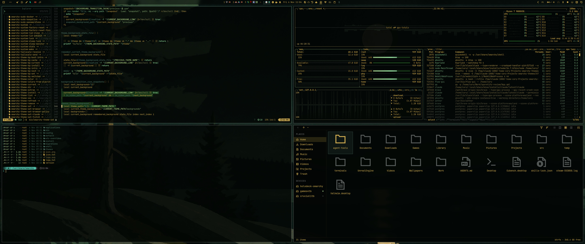

# Maine Summer Dark — Omarchy theme



## Install

```
omarchy-theme-install https://github.com/lutzlstein/omarchy-maine-summer-dark-theme
```

Aether (adds it to your blueprints and applies it):

```
aether --import-blueprint https://raw.githubusercontent.com/lutzlstein/omarchy-maine-summer-dark-theme/main/blueprint.json --auto-apply
```

## Palette

| Name | Hex | Swatch |
|---|---|---|
| accent | `#446457` |  |
| selection | `#163717` |  |
| selection_foreground | `#91d99a` |  |
| muted | `#3f4542` |  |
| background | `#020604` |  |
| dark_background | `#020503` |  |
| darker_background | `#010302` |  |
| lighter_background | `#1b1f1d` |  |
| foreground | `#d3af51` |  |
| dark_foreground | `#9e833d` |  |
| light_foreground | `#dabb6b` |  |
| bright_foreground | `#dec37d` |  |
| red | `#717155` |  |
| yellow | `#d5f5ab` |  |
| orange | `#86866f` |  |
| green | `#8db177` |  |
| cyan | `#91d99a` |  |
| blue | `#446457` |  |
| magenta | `#9a8650` |  |
| brown | `#505043` |  |
| bright_red | `#8b8959` |  |
| bright_yellow | `#d5fca0` |  |
| bright_green | `#a5d48a` |  |
| bright_cyan | `#a9ffb3` |  |
| bright_blue | `#4e7867` |  |
| bright_magenta | `#c2a24e` |  |

Icons: `Yaru-yellow`

## Backgrounds credits

- `1-moonlit-lake-loon.webp`: AI-generated with ChatGPT by Cory Blische.

### Made with Oma Easel

These backgrounds were generated by Cory Blische with [Oma Easel](https://github.com/lutzlstein/oma-easel), in the style and colors of this theme's original background.

- `2-slightly-less-expressionist.webp`: made with Oma Easel using Codex's image tool, from the prompt “slightly less expressionist”.
- `3-fractal-abstraction.webp`: made with Oma Easel using Codex's image tool, from the prompt “fractal abstraction”.
- `4-bauhaus.webp`: made with Oma Easel using Codex's image tool, from the prompt “bauhaus”.
- `5-interior-forest-scene-small-stream.webp`: made with Oma Easel using Codex's image tool, from the prompt “interior forest scene with small stream running through the trail. expresssionst, broad strokes”.
- `7-add-boat.webp`: made with Oma Easel using Codex's image tool, from the prompt “add a boat”.

The background images are released under the same MIT license as the rest of this theme.

## License

MIT, see [LICENSE](LICENSE).
